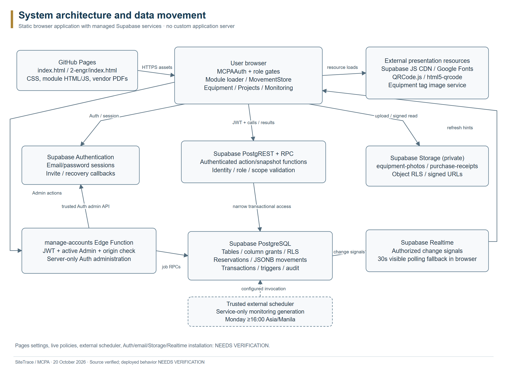

# 1. System overview

SiteTrace is the requested documentation name for the repository's MCPA construction asset management and accountability application. The current interface also uses BuildRight Corp. branding. MCPA is expanded as Material & Construction Property Allocation in PRODUCT.md. Organization and sample project names are interface/product context, not independently confirmed operating-company evidence.

The system records construction equipment identity, location, accountable holder, operational condition and movement history. It supports equipment requests and Admin review, whole-record allocations, direct project handovers, named-recipient inspection/testing, Office returns, repair cases, loss/recovery, separate consumable stock and purchase records, role-scoped reports and company-account management.

This edition reviews repository revision a5d51b3 on 20 October 2026, Asia/Manila. The workbook contains the detailed feature inventory and permission matrix; the diagram folders contain editable draw.io sources and matching PNG/PDF exports. Source references identify repository-relative paths. Source inspection does not establish production installation or successful live transactions.

NEEDS VERIFICATION: current deployed commit, database catalog, applied migration chain, Storage policies, Edge deployment, scheduler, authenticated live screens and Project Manager/QA approval. No production account or private record was accessed. An unauthenticated web-tool request to the Pages address inferred from the Git remote was inaccessible; this does not prove that the site is offline. No live screenshot is claimed.

Sources: index.html; 2-engr/index.html; PRODUCT.md; js/permissions.js; js/data.js; SUPABASE-RELEASE-READINESS.md.

# 2. Purpose and objectives

The implemented controls support an accountability chain: identify an asset, record a request or handover, preserve the current holder until physical receipt, and save inspected outcomes with related activity. The product's “input first, out second” principle is reflected in reservations and saved movement operations. It is an operational objective, not a claim that the software can prove physical possession without truthful inspection.

- Keep stock allocations distinct from physical custody so approvals and pending handovers do not silently change the accountable person.
- Bind company actions to an active authenticated permanent profile rather than a browser-selected name.
- Restrict field views to personal custody, assigned projects and authorized related movement context.
- Preserve historical evidence when assets are returned, damaged, lost, recovered or moved between projects.
- Maintain decimal consumable stock through transactional adjustments and receipts, independently of the procurement ledger.
- Produce current and prospective historical monitoring with explicit dates and role-scoped PDF exports.

PRODUCT.md names broader lifecycle aspirations including Borrowed, Sold and other states. Current movement handlers do not establish dedicated end-to-end operations for every named lifecycle term. No performance benchmark, guaranteed inventory accuracy, customer adoption or production-security certification is asserted.

Sources: PRODUCT.md; js/movement-store.js; js/permissions.js; supabase/migrations/202610060002_recipient_identity.sql.

# 3. Technology stack

| Layer | Repository implementation |
| --- | --- |
| Browser interface | Plain HTML5, CSS and JavaScript; no React/Vue application framework or required frontend build. |
| Entry pages | Root index.html and 2-engr/index.html. Either entry uses authentication and role gates. |
| Client backend SDK | Supabase JavaScript SDK loaded from jsDelivr with major version @2. Exact delivered browser patch is not pinned. |
| Authentication | Supabase Auth email/password, persistent SDK session, invite/recovery callback handling. |
| Database | Supabase PostgreSQL, JSONB movement records, relational allocation links, RLS, SQL/PLpgSQL RPCs and triggers. |
| Files | Private Supabase Storage equipment-photos and purchase-receipts buckets; signed retrieval URLs. |
| Account service | Deno manage-accounts Edge Function; npm Supabase SDK 2.117.2 in its entry source. |
| QR | QRCode.js 1.0.0; html5-qrcode 2.3.8; external api.qrserver.com equipment-tag images. |
| Reports | Vendored jsPDF 4.2.1, jsPDF-AutoTable 5.0.8 and Noto Sans regular/bold; local browser PDF creation. |
| Fonts | Google Fonts Fraunces, Public Sans and JetBrains Mono for interface presentation. |
| Static hosting | GitHub Pages branch/root configuration described in repository release notes. Current settings unverified. |
| Development evidence | Node test scripts, PGlite 0.5.8 fixtures, browser harnesses, PDF validation sources. These are not production services. |

The frontend directly calls managed backend services; there is no separately implemented Node application server or custom REST API server. Package manifests under tests/ and scripts/ support development, QA and vendored report assets. Documentation generation reuses locally installed Node/Chrome and produces files only under SYSTEM_DOCUMENTATION/.

Sources: index.html; 2-engr/index.html; tests/package.json; scripts/package.json; vendor/pdf/manifest.json; supabase/functions/manage-accounts/index.ts.

# 4. Frontend architecture

SCREEN_MODULE maps sixteen screen identifiers to fourteen primary modules; tool-profile is bundled with masterlist and site-detail with sites. Root and field entries load shared JavaScript services on window. Auth controls whether the shell is shown. loadModule checks route access before fetching HTML, adds module CSS, loads its script, and calls route-specific rendering.

The loader aborts superseded requests, tracks an in-flight module, disposes watchers and transient UI state when changing modules, and offers a retry when resources cannot load. CSS is attached once per module; record links and browser history preserve authorized context. Mobile navigation and history are shared services.

| Shared component | Responsibility |
| --- | --- |
| MCPAAuth / MCPAPermissions | Session/profile lifecycle; role routes; action hints; explicit demo boundary. |
| EquipmentTracking / EquipmentPhotos | Authorized inventory reading, quantity/status/requestability, watchers and private images. |
| MovementStore / movement-cloud | Demo/live mode, normalized snapshots, RPC mutations, operation retry tracking and change events. |
| MovementUI / MovementOverview | Operational forms, inspection and detail views; equipment/activity overview surfaces. |
| Project scope / dashboard view | Assigned project context, quantity-based cards, review queues and record navigation. |
| Global search / navigation services | Role-scoped equipment, project, movement, material, purchase and report-view discovery; exact record/history/mobile behavior. Secretary searches Materials/Purchases only. |
| MCPAMonitoring / PDF reports | Notifications/overdue refresh; local PDFs from already-authorized loaded rows. |

Engineer and Architect normally load 2-engr modules. Projects, Materials, Users, Settings, Reports and Purchases deliberately use current shared Admin implementations, subject to route gates. Tool Handler equipment uses the read-only field tracking implementation. A file's presence under 2-engr does not prove the role can reach it; old Users/Reports/Settings files contain legacy material.

The fourteen sidebar labels/routes are Dashboard/dashboard, Equipment Tracking/masterlist, Projects/sites, Requests/request, Transfers/transfer, Returns/return, Repairs/repair, Missing/missing, Material Requests/consumables, Purchases/purchase, Reports/reports, Activity Logs/activity, People & Accountability/users and Settings/settings. Secretary starts at Material Requests; other roles start at Dashboard.

Offline demo is explicitly selected and stores sample state in the browser. Only Admin/Engineer/Architect demo modes are offered. Users, Materials and Purchases are excluded in demo; Projects is read-only and live receiving QR is unavailable. Demo records are not operational evidence and do not grant database access. The shared sample TOOLS array is not a source of production inventory truth.

Sources: js/data.js; js/app.js; js/auth.js; js/navigation.js; js/navigation-history.js; js/mobile-navigation.js; js/movement-store.js; js/movement-cloud.js.

# 5. Backend architecture and request flow

GitHub Pages supplies static assets. The browser obtains an Auth session from Supabase and sends authenticated calls through the Supabase SDK. Direct table requests pass through PostgREST and table/column grants plus RLS. RPCs return authorized projections or execute bounded transactions. Storage separately applies object policies before upload or signed retrieval. The account Edge Function is a privileged intermediary for Auth administration, not the movement service.

A typical movement request follows these steps:

1. Auth establishes the session; mcpa_my_profile resolves the company person and UI role.
2. A scoped snapshot supplies eligible assets, related movement data and server-computed allowedActions where installed.
3. The form sends an action, JSON payload and operation UUID to mcpa_movement_action.
4. The current wrapper chain validates identity, role, state and additional Office/QR/cancellation conditions. The authenticated lifecycle binds the actor from the trusted profile.
5. Advisory transaction locks and equipment row locks protect reservations and state changes. The transaction saves movement, relational links, equipment outcomes and operation activity together.
6. The future-operation notification trigger creates permitted notices in the same transaction. The response returns the saved result; readers refresh through authorized snapshots.

The source contains layered renames/delegates. The reviewed Office chain can wrap portal directly or cancellation then portal. Both arrangements are supported by release-compatibility tests; a missing archived cancellation delegate alone does not establish an Office failure. Cancellation controls depend on the installed gateway and server-supplied allowedActions. The October 15 availability migration wraps the snapshot reader separately and enriches authorized tools with recordedStatus, movementLock and a version marker.

The source does not establish a complete migration replay from an empty project. Core profiles/equipment DDL is missing, legacy setup ordering matters, and two current migration filenames share the version prefix 202610120003. This is a release-management verification item, not something this documentation task corrected or executed.

Sources: js/movement-cloud.js; 1-admin/modules/movements/setup.sql; supabase/migrations/202610040001_authenticated_access.sql; supabase/migrations/202610060002_recipient_identity.sql; supabase/migrations/202610100001_engineer_portal.sql; supabase/migrations/202610100004_movement_cancellation.sql; supabase/migrations/202610120002_office_returns.sql; supabase/migrations/202610150001_inventory_availability.sql; SUPABASE-RELEASE-READINESS.md.

# 6. Authentication and role management

Supabase Auth owns password verification and sessions. The application does not authorize users by choosing a role at login. The active company identity is a public.profiles row whose auth_user_id matches auth.uid(). profiles.id is a permanent person identifier; the independent-profile migration removes the reviewed legacy coupling of that person ID to Auth identity while retaining the separate auth_user_id link.

The frontend denies unknown, inactive or unlinked profiles. The private identity() helper independently requires an active profile and one of the five supported role values. The visible shell does not replace backend checks. Focus/storage/Auth events and a 60-second visible-page check revalidate the session; logout clears loaded workspace state and requests local-scope SDK sign out.

| Role | Effective application responsibilities |
| --- | --- |
| admin | Company dashboard/inventory; metadata and projects; request approval/rejection/release; repair/recovery; Materials/Purchases; Reports; accounts; movement monitoring. |
| engineer | Own custody; assigned projects; eligible equipment requests; held-equipment transfers/returns/fault/loss reporting; named-recipient inspection; eligible interruptions. |
| architect | Same route/action set and custody/assignment rules as Engineer. |
| secretary | Materials stock/request/receipt functions; purchase ledger/files; Settings. No equipment or report route. |
| tool_handler | Company equipment/projects and movement monitoring; dispatch of eligible unheld Available stock; Activity/Settings. No named-receiver receipt, request review or field interruptions. |

NEEDS VERIFICATION: actual deployed grants and users' current role/status/linkage. No named account or personal profile is included. The workbook's Role Matrix records action-level conditions. Informal product descriptions such as Sir/Ma'am are not additional stored roles.

The base equipment metadata policies/column grants admit Admin and Tool Handler, whereas the current UI Add/Edit form explicitly requires Admin and Tool Handler gets a read-only view. Managed private photos add an Admin-only trigger/policy. This difference is documented because UI visibility and backend privilege are separate facts.

There is no public signup. Admin can invite Engineer, Architect, Secretary or Tool Handler through manage-accounts if email invitations are enabled. The Edge handler verifies the bearer token with Auth.getUser, checks an active Admin profile, validates origins and uses durable prepare/claim/finish jobs. Retries reconcile the same person rather than replacing historical identity. Existing account links cannot be reassigned or removed through mcpa_save_account; self-removal of Admin access and new Admin promotion are refused by that function.

Invitation/recovery callbacks enter password setup with a valid Auth session. The form requires at least 12 characters and signs out after saving. Expired callbacks lead to a fresh invitation/reset instruction. Email delivery, redirect allowlists and callback behavior in the deployed environment remain unverified.

Development-account creation is a separate capability, disabled unless enabled in Edge configuration. It creates real Engineer/Architect accounts with a 12–128-character password and a durable job that does not store the password. It is not offline demo, and it can access company records when enabled. The documentation process never called it.

Sources: js/auth.js; js/permissions.js; 1-admin/modules/users/users.js; supabase/functions/manage-accounts/handler.mjs; supabase/migrations/202610050002_independent_profile_identity.sql; supabase/migrations/202610060001_account_management.sql; supabase/migrations/202610060003_development_accounts.sql.

# 7. Database structure

The schema catalog in this folder records the exact repository CREATE TABLE bodies and their source lines. Twenty-one distinct tables have explicit CREATE TABLE definitions in application SQL. profiles and equipment are additional referenced application tables with incomplete original DDL, giving twenty-three documented application entities. auth.users and storage.objects/storage.buckets are managed service dependencies, not complete repository-defined entities.

NEEDS VERIFICATION: a sanitized current catalog/schema export is required to establish installed columns, types, primary/foreign keys, enum labels, nullability/defaults, indexes, policies, owners, trigger states, function bodies/signatures/grants, Realtime publication membership and migration/delegate chain. Do not export Auth rows, account emails, passwords, object contents or secret configuration.

| Entity group | Tables and structural responsibility |
| --- | --- |
| Identity and projects | profiles: stable person and Auth linkage; sites: project metadata and one accountable profile; project_history: metadata before/after snapshots. |
| Equipment | equipment: internal ID, displayed asset code, quantity/metadata, saved status, site and current holder as consumed by source. Base DDL incomplete. |
| Operational movements | mcpa_movements: request/transfer/return/repair/missing discriminator and JSON data; actor/destination/receiver UUIDs. |
| Movement links and allocation | mcpa_movement_assets: selected equipment; mcpa_movement_sites: related project context; mcpa_movement_reservations: one current allocation per equipment. |
| Operation and interruption evidence | mcpa_movement_operations: UUID action/payload/result/activity; mcpa_movement_cancellations and mcpa_movement_refusals: before/after interruption evidence. |
| Bulk consumables | consumables, consumable_requests, consumable_stock_movements: decimal balances, per-item purchase requests and linked stock transactions. |
| Procurement | mcpa_purchases, mcpa_purchase_history: versioned supplier/reference/date and JSON line items; history keyed by operation UUID. |
| Account jobs and audit | mcpa_account_invitations, mcpa_account_audit, mcpa_development_accounts: durable trusted service jobs and access-change evidence. |
| Monitoring | mcpa_notifications: own-recipient event/read state; mcpa_inventory_snapshots: immutable prospective weekly tools JSON. |
| Private configuration | mcpa_auth_private.receiving_qr: token hash/receiver/site/expiry/revocation; mcpa_auth_private.return_office: one pinned Office site. |

The model deliberately stores business movement status, tool code arrays, inspection details, notes and cross-record references in JSONB. The relational asset/site junctions support locking and visibility. Do not infer standalone requests/transfers/returns/repairs/missing tables: these are kinds inside mcpa_movements. Do not infer a project_members table: the current project model uses one assigned_engineer_id.

Important verified constraints include movement kind checks, object-shaped movement data and matching data.id, composite movement/asset and movement/site primary keys, an equipment-keyed reservation primary key, and operation UUID uniqueness. Cancellation audit has a composite operation/movement primary key; refusal audit has operation_id as primary key. Most declared operational links use ON DELETE RESTRICT to preserve evidence.

Consumables use numeric(12,3), nonnegative bounded balances, normalized unique item names, generated stock_status, one open pending/partial request per item, constrained receipt totals and request-state consistency. Ledger totals use numeric(18,2); purchase line quantities allow three decimals and unit prices two; the server recomputes rounded line totals. Supplier/reference/date has a normalized unique index.

sites has normalized unique names, progress 0–100 and a restricted status vocabulary: active, discrepancy, verified, turnover, idle, planning, completed. is_active/archived_at control archival independently of that display status. return_office uses a boolean primary key with CHECK(singleton), allowing only the true singleton. Notifications deduplicate on recipient_id/dedupe_key; inventory snapshots require a Monday week_start and unique week_start.

The original equipment status enum/type and full profiles/equipment constraints are not available. The executable status setter writes AVAILABLE, IN_USE, REPAIR and MISSING. UI normalization also recognizes legacy labels such as IN_OFFICE and retired/disposed; this does not prove the complete installed enum or a corresponding write operation. Optional equipment fields read with to_jsonb may be absent without proving a schema definition.

Sources: 1-admin/modules/sites/setup.sql; 1-admin/modules/movements/setup.sql; 1-admin/modules/consumables/setup.sql; supabase/migrations/*.sql; Schema_Catalog.md; ../05_VALIDATION/Repository_Index.json.

# 8. Entity relationships

The ERD is split into four readable views: core identity/projects, movement allocation/audit, materials/procurement, and account/monitoring support. Solid crow's-foot connectors identify repository-declared foreign keys. Dashed connectors identify application associations or service links whose physical foreign-key definition was not found. Each connector labels its actual referencing field; repeated parent boxes are the same table shown for context.

| Parent | Child / reference | Verified relationship |
| --- | --- | --- |
| auth.users | profiles.auth_user_id | Nullable UUID FK with ON DELETE SET NULL and unique non-null index: at most one company profile per linked Auth identity. profiles.id is independent. |
| profiles | sites.assigned_engineer_id | Nullable declared FK; one accountable profile per project and many projects per profile. |
| sites | project_history.project_id | Required FK; project to many metadata events. actor_id is not declared as a profile FK in this table. |
| profiles / sites | mcpa_movements.actor_id / receiver_id / destination_id | Required actor FK; optional receiver and destination FKs. |
| mcpa_movements / equipment | mcpa_movement_assets | Composite-key junction; many equipment links per movement and historical movements per equipment. |
| equipment / mcpa_movements | mcpa_movement_reservations | equipment_id primary key limits equipment to one reservation; a movement can reserve many equipment records. |
| mcpa_movements / sites | mcpa_movement_sites | Composite-key context junction. |
| operations / movements / profiles | Cancellation/refusal audit fields | Declared operation, movement and actor FKs. |
| consumables | Requests and stock movements | Required item FKs; stock request_id is nullable and required for receipt kind. |
| consumable_requests | mcpa_purchases.request_id | Optional purchase-to-request FK; saving a ledger entry does not change stock. |
| profiles | Purchase/account/notification/QR records | Specific declared actor/recipient/profile/creator FKs shown in detailed views. |
| sites | receiving_qr.site_id / return_office.site_id | Declared FKs to receiving project and configured Office. |

equipment.site_id and equipment.current_holder_id are joined and updated consistently by the application, but their original FK definitions are missing. They appear as dashed semantic associations in the core ERD. equipment.id is a referenced UUID identity; its original primary-key declaration is NEEDS VERIFICATION. profiles.id primary-key expectations are explicitly checked in the identity migration.

JSON strings such as requestId, transferId, sourceId, activity.entityId, notification.entity_id, purchase.receipt_path and equipment.image_url are not silently represented as relational foreign keys. The operation result/history link and Storage object references are resolved in application/RPC logic. There is no assertion that the ERD is the full current production schema.

Sources: Schema_Catalog.md; supabase/migrations/202610050002_independent_profile_identity.sql; supabase/migrations/202610060002_recipient_identity.sql; ../02_SYSTEM_DIAGRAMS/Entity_Relationship_Diagram/README.md.

# 9. Supabase Storage

Two private buckets are defined. equipment-photos accepts JPEG, PNG and WebP up to 5 MiB; purchase-receipts accepts PDF and those image types up to 10 MiB. Source guards reject conflicting existing bucket settings or unrelated broad object policies rather than silently replacing them. Installation and effective policies in production remain NEEDS VERIFICATION.

Equipment photo paths use a safe asset folder and random UUID filename. The browser checks MIME, byte size and image signature, stages a unique upload with upsert:false, and stores a storage://equipment-photos/... reference in image_url. The database trigger verifies an uploaded object and Admin authority for managed photo-reference changes. A metadata-save failure preserves the staged upload/form for retry rather than overwriting the previous file.

EquipmentPhotos resolves authorized references to 3600-second signed URLs, caches them by company profile for 50 minutes and refreshes visible images. Read access follows authorized tool visibility, with Admin override; it is broader than personal-custody view alone when the backend visibility helper permits related tools. A failed image does not remove equipment details. Signed URLs are temporary access material and should not be copied into public documentation.

Purchase receipts are organized under purchase UUID / object UUID, staged before ledger save and validated by object existence and path. Admin/Secretary can access them; the opening handler generates a 300-second signed URL and may need popup permission. No storage UPDATE/DELETE policy is created by the feature migration: replacement uses a new path and retains prior versions. This can retain orphan staged uploads after a failed business save; any cleanup requires a separately reviewed retention procedure.

Sources: js/equipment-photos.js; 1-admin/modules/purchases/purchases.js; supabase/migrations/202610100003_feature_storage.sql; supabase/migrations/202610100005_purchase_ledger.sql.

# 10. Backend security, RLS and RPC responsibilities

The authenticated-access migration enables RLS, revokes old table and separately granted column privileges, removes prior prototype policies, then installs narrow grants/read policies and authenticated wrappers. Legacy handover lockdown removes browser entry to old actor-supplied movement functions. Effective deployed RLS still depends on current policy catalog, ownership and privilege installation; source presence alone cannot establish it.

| Surface | Intended repository boundary |
| --- | --- |
| Equipment direct read | Active Admin/Tool Handler. Field users use projected authorized snapshots. |
| Equipment direct write | Admin/Tool Handler metadata columns only; insertion must be unheld AVAILABLE at Office under the newer policy. UI write form is Admin-only. |
| Sites write | Admin under RLS; Company read for Admin/Tool Handler; field assigned readers via RPC. |
| Movement tables | Browser direct table access revoked; authorized snapshot and transactional action RPCs. |
| Materials tables/RPCs | Admin/Secretary; direct reads under RLS; balances changed through wrapped transactional RPCs. |
| Purchases/history | Admin/Secretary read; versioned save RPC; append-only history triggers. |
| Account jobs | Trusted service RPCs plus active-Admin validation; browser cannot perform job transitions directly. |
| Notifications | Own recipient reads and own mark-read RPC; event fields immutable. |
| Inventory snapshots | Admin reader; service-role-only capture/generation. |
| Private schema | No browser schema/table/function access; public entrypoints delegate internally. |

Security-definer functions run with owner authority and therefore perform their own identity/role/scope checks. Reviewed functions use an empty search_path and qualified object names. The browser publishable configuration is not an authorization boundary. No key value, endpoint credential, password, session, invitation link or receiving token is reproduced in this package.

| RPC family | Responsibilities |
| --- | --- |
| mcpa_my_profile; mcpa_has_role | Resolve linked identity and active role predicates. |
| mcpa_movement_snapshot | Authorized tools/users/sites/movements/activity; optional allowedActions and availability enrichment. |
| mcpa_personal_equipment_snapshot; mcpa_project_snapshot | Narrow field custody and assigned-project views. |
| mcpa_movement_action | Role/state/ownership validation, reservations, inspection outcomes, idempotent operation result and audit. |
| mcpa_create/resolve/revoke_receiving_qr | Temporary receiver/project context; assignment and expiry validation. |
| mcpa_return_destination; mcpa_inventory_office | Read validated Office metadata for return or registration context. |
| consumables_save_item / adjust_stock / create_request / receive_request / cancel_request | Validated decimal stock, request state and transactional stock evidence. |
| mcpa_save_purchase; mcpa_purchase_snapshot | Versioned ledger save and authorized ledger/history projection. |
| mcpa_accounts; mcpa_save_account | Admin account list and preserved-identity access changes. |
| mcpa_invitation_step; mcpa_development_account_step | Service-only durable account job transitions. |
| mcpa_monitoring_snapshot; mcpa_monitoring_mark_read; mcpa_monitoring_report | Scoped notices/overdue; own read state; Admin dated reports. |
| mcpa_capture_inventory_snapshot; mcpa_generate_monitoring | Trusted backend generation, actual dates and deduplication; no browser execution grant. |
| mcpa_can_* Storage predicates | Validate bucket paths, role and related tool/file scope for object policies. |

Movement payloads are bounded (128 KiB in the lifecycle/wrappers), selected tool arrays contain 1–100 distinct valid identifiers, and positive quantity is required. Idempotency compares the original action/payload for the same operation UUID; a reused UUID with changed values produces a concurrency error. Locks serialize critical movement operations at this application's scale. This is a correctness design, not a measured scalability claim.

Immutable update/delete/truncate triggers are explicitly defined for project history, purchase history, cancellation/refusal and monitoring records (notification read_at is the permitted exception). Movement operation evidence and stock history have browser write restrictions; do not assume every audit-like table has the same immutable trigger coverage. Account audit read/write restrictions should likewise be checked in the current catalog.

Sources: supabase/migrations/202610040001_authenticated_access.sql; supabase/migrations/202610050001_legacy_handover_lockdown.sql; supabase/migrations/202610060001_account_management.sql; supabase/migrations/202610100002_project_history.sql; supabase/migrations/202610100003_feature_storage.sql; supabase/migrations/202610100004_movement_cancellation.sql; supabase/migrations/202610100005_purchase_ledger.sql; supabase/migrations/202610100006_monitoring.sql.

# 11. Equipment and asset tracking logic

An equipment record has an internal UUID used by relational links and a displayed asset_id used by operational selection and tags. The current Admin registration form generates a T- prefix plus sixteen uppercase hexadecimal characters from a random UUID; it separately generates the internal UUID and retains them across retry. Serial number is descriptive metadata, not the movement database key. The source does not establish the original asset_id uniqueness constraint; that must be checked in the missing core schema.

Registration captures equipment type/name, category, brand, model, serial, condition, identifying details and Individual or Bulk tracking. Individual stores quantity one; Bulk stores the entered quantity/unit. New records submit status AVAILABLE without a holder or explicit site. The prospective Office insert trigger supplies the pinned Office and the newer insert policy validates it. Existing historical locations are not rewritten by this trigger.

EquipmentTracking.requestability separates recorded status from permission to make a new stock request. It excludes inactive/archived records, quantity zero, missing/lost, damage/repair, retirement/disposal, pending/refused transfer allocation, approved reservations, existing holders and unknown allocation information. Location at an active project alone does not make unheld AVAILABLE stock unavailable. Pending requests alone do not reserve assets.

Raw IN_OFFICE may have been normalized to available in legacy snapshots, but the write validator accepts raw AVAILABLE for stock requests. The availability enrichment preserves raw recordedStatus and reveals only the lock category, not another person's private request details. Without installed enrichment, field stock can show Availability unverified and remain excluded; Admin can use a successfully loaded company movement snapshot as a fallback.

Movement is by full asset record and its complete recorded quantity. Selecting part of a scaffolding set/bulk record, splitting a record or partly physically receiving a tool is not implemented. Lost/damaged inspections apply to the selected record. Consumables use a separate decimal stock model with partial receipts; those capabilities should not be generalized to equipment.

Sources: 1-admin/modules/masterlist/masterlist.js; js/equipment-tracking.js; js/movement-ui.js; supabase/migrations/202610120003_equipment_office_default.sql; supabase/migrations/202610150001_inventory_availability.sql; documentation/inventory-status-verification.md.

# 12. Project assignment and custody management

public.sites represents projects, retaining legacy table names and IDs. assigned_engineer_id holds one accountable person per project, even when that person is an Architect. A profile can own multiple assignments. Legacy assigned_engineer text remains display/history context; stable UUIDs control current assignment checks.

Field Projects reads assigned sites, related inventory and project metadata history through mcpa_project_snapshot. Own Equipment Tracking is narrower: it contains confirmed personal custody. Movement/request catalog scope may additionally include unheld requestable stock, assigned-site context and pending incoming assets. These are distinct authorized views, so their record counts can legitimately differ.

Project archive/restore changes is_active and archived_at and retains historical records. Active assigned projects are required for requests and receiving context. Project status labels such as completed are distinct from is_active. Admin edits project assignments; field users have no self-assignment control. QR context is rejected if the receiver/project assignment changes after generation.

Custody is represented by equipment.current_holder_id and location by site_id. Request approval and pending dispatch reserve assets while preserving both. Good or accepted-damaged receipt assigns the named field receiver and destination; missing items retain their last holder/site. Return-good clears custody at Office; the newer Office wrapper also clears custody for physically returned damaged items. Missing-on-return retains accountability. Standalone repair/loss reports do not transfer custody to a different person.

Sources: 1-admin/modules/sites/sites.js; js/project-scope.js; supabase/migrations/202610100001_engineer_portal.sql; supabase/migrations/202610060002_recipient_identity.sql; supabase/migrations/202610120002_office_returns.sql.

# 13. Request and approval workflow

1. Engineer/Architect selects whole eligible records and an active project assigned to their stable profile. Purpose is optional under the current optional-purpose migration; maximum 2000 characters remains. The needed-until date and form validation are checked by the lifecycle. Material request purpose is a separate required field.
2. createRequest saves Pending with requester/receiver identity and selected asset links. No reservation or custody change occurs yet. Multiple pending requests do not prove allocation.
3. Admin may reject the current pending request or approve after rechecking stock and competing allocations. Approval reserves each asset through its unique equipment reservation row. A concurrent state change is rejected rather than silently overwriting allocation.
4. Admin releaseRequest verifies the approved allocation and active operational receiver, creates a pending transfer and replaces request reservation links with transfer reservation links. The request becomes Released and records transferId. Custody remains at source until inspection/receipt.
5. The named receiver looks up the handover and completes per-tool testing/conditions. Successful receipt changes the transfer and linked request to Received; asset outcomes depend on inspection. Related queues/notices reflect this saved linkage.

When cancellation support is installed, only the eligible Engineer/Architect requester can withdraw a pending request or cancel an approved unreleased reservation. Reason/confirmation and server allowedActions are required. A saved request has no verified general edit/resubmit operation. Received records cannot be undone using these controls.

Sources: js/movement-ui.js; js/permissions.js; js/dashboard-view.js; supabase/migrations/202610060002_recipient_identity.sql; supabase/migrations/202610100004_movement_cancellation.sql; supabase/migrations/202610120003_optional_request_purpose.sql.

# 14. Transfers, receiving, returns and exception workflows

## 14.1 Direct transfer and two QR meanings

Engineer/Architect can initiate a transfer only for their eligible held In Use assets. Tool Handler can dispatch eligible unheld AVAILABLE stock. The portal wrapper checks an active Engineer/Architect receiver and an active project assigned to that receiver. Manual receiver/project selection is supported alongside QR-assisted context.

A receiving QR supplies temporary receiver/project identity. It uses a 64-character hexadecimal token, stores only a SHA-256 hash privately, expires after 15 minutes and revokes the receiver's prior active token on creation. Token resolution rechecks expiry, revocation, active linked receiver and current project assignment. The wrapper strips receivingToken before movement/audit persistence. Generating or revoking QR is a normal application write, and was not executed during documentation.

A handover QR/code locates an already saved transfer for the named receiver. It is distinct from an asset tag, which encodes an equipment asset ID, and from the temporary receiving QR. Scanning any QR does not by itself approve receipt or move custody. Camera scanning depends on the loaded library, supported browser/device and camera permission; manual code entry remains useful when available.

## 14.2 Inspection and refusal

Only the named active receiver can confirm a transfer. Exactly one valid condition is required for every selected tool. Every non-missing received tool must be tested. Damaged or missing items require notes of at most 2000 characters; accepted damage needs an explicit custody decision. SQL uses lost for the inspection choice that produces equipment MISSING.

Good items become IN_USE under the receiver at the destination. Accepted-damaged items move there under that receiver with REPAIR status and a repair report. Missing items become MISSING with a loss case while retaining source holder/site. The transaction records inspections, updates linked request/transfer state and releases reservation only on committed receipt.

Where optional cancellation/refusal support is installed, an eligible named field receiver can decline damaged custody. The entire handover becomes Refused; equipment status/custody and reservation are retained, and refusal evidence is immutable. The original field sender can reopen or cancel; a linked released-request requester can cancel the corresponding pending/refused handover. The exact owner/state rules come from allowedActions and backend can_adjust_movement. Admin, Secretary and Tool Handler cannot use these interruption actions.

## 14.3 Office return and receiving outcome

The field holder selects eligible whole In Use records and records each condition. mcpa_return_destination supplies the fixed Office; there is no project destination dropdown in the current return workflow. The gateway pins the Office by existing site UUID, checks active/unique configuration, rejects forged destinations and preserves idempotent historical retries.

Return submission itself finalizes inspected receiving in one transaction; there is no separate Admin acceptance, scheduled pickup, return QR or second receiving confirmation stage. Good items are AVAILABLE at Office with no holder. Physically returned damaged items enter REPAIR at Office and the Office wrapper clears personal holder. Missing items retain previous holder/location and open a missing case. Older manuals that retain damaged-return holder describe the underlying legacy engine before this wrapper.

## 14.4 Repair, missing and recovery

A field holder can report damage or loss for eligible held In Use equipment. A repair case begins reported, can become underrepair through Admin startRepair, and completed through completeRepair. Raw equipment remains REPAIR while the case-derived presentation says Under Repair. Completion clears the holder and sets AVAILABLE at a recorded destination (or preserves existing site where the lifecycle permits).

A missing case preserves holder/location and circumstances. Admin recovery requires a recovered condition; good recovery becomes AVAILABLE and clears holder. Damaged recovery clears holder, sets REPAIR at the recorded destination and creates a linked repair case. Repair/recovery guards reject changed equipment/case states. No verified technician assignment, service-cost ledger, preventive schedule, repair evidence-photo form or field recovery authority is present.

Sources: js/movement-ui.js; js/permissions.js; supabase/migrations/202610060002_recipient_identity.sql; supabase/migrations/202610100001_engineer_portal.sql; supabase/migrations/202610100004_movement_cancellation.sql; supabase/migrations/202610120002_office_returns.sql.

# 15. Materials, procurement, notifications and activity

## 15.1 Consumable stock and purchase ledger

Admin/Secretary manage decimal stock for consumables. Registering an item creates opening stock evidence; edits preserve its unit and use version checking. Usage subtracts quantity, restock adds it, and count correction sets the verified counted balance with a mandatory note. Negative stock is blocked and numeric precision is limited to three decimals.

A single-item material Purchase Request has no separate Admin approval stage. Creation leaves stock unchanged and only one pending/partial request is allowed per item. Partial/full receipts increment stock and record receipt evidence, bounded by outstanding quantity. Cancellation closes the remainder and preserves previously received stock. Version and operation IDs prevent stale/duplicate adjustments.

Purchases is a separate supplier/invoice/date/item-price ledger. Entries can optionally link to a material request and private receipt, then display that request's delivery status. Saving/editing a purchase never receives or increments consumable stock. The server validates lines and totals, detects duplicate references, uses optimistic versions and retains before/after history.

## 15.2 Notifications and synchronization

The future movement-operation trigger creates deduplicated in-app notices for active Admin and related actor/receiver profiles, excluding the current performer. The turnover update adds equipment names and linked receipt context for release notices. Existing history is not backfilled. Notifications are not confirmed email/SMS/push delivery features.

MCPAMonitoring reads own notices/unread count and scoped overdue records. Opening/marking a notice read calls a write RPC restricted to its recipient. Realtime subscriptions and generally 30-second visible-page polling/focus/reconnect refresh support synchronization. Realtime channel success alone is not proof that business reads succeeded; the reader verifies current state. Physical device/network behavior and deployed publication membership remain unverified.

## 15.3 Reports, dates and audit boundaries

Overdue calculation compares neededUntil with the current Manila date for received requests, current holders and the newest successful physical receipt linked to that loan. A previous returned/reacquired loan should not revive an old due date. Admin/Tool Handler get company overdue context; field users get their own.

Trusted generation creates daily deduplicated overdue notices and weekly notices/capture at or after Monday 16:00 Asia/Manila. It depends on an external trusted scheduler; the migration does not install a job. Captures record actual current inventory once per Manila week, not reconstructed past stock. Missing past snapshots must be shown as absent.

Admin Reports provides current inventory, selected stored snapshots and date-filtered movement history. The valid inclusive range is up to 367 days. Current inventory remains current even when a historical period is selected. Date changes disable exports until the requested period loads; failed loads must not export stale data. Activity Logs exports the currently authorized matching movement activity for Admin, Engineer, Architect and Tool Handler.

Current export controls generate PDFs locally from existing authorized arrays, with branding, Manila times, counts, repeated headers, filter context, embedded Noto Sans and page totals. Original timestamps are retained alongside Manila display. Unsupported glyphs use [U+XXXX] notation rather than silent deletion. CSV and inert legacy report buttons in older documentation are superseded by the current PDF implementation. Inventory and equipment-tag print windows are separate printing surfaces.

Activity Logs is movement activity, not one combined system audit. Project History, Stock History, Purchase History and Account access history remain separate stores/views. Admin equipment profile history is not a verified complete cross-module history; use saved movement records and Activity Logs for accountable movements.

Sources: 1-admin/modules/consumables/setup.sql; 1-admin/modules/consumables/consumables.js; 1-admin/modules/purchases/purchases.js; js/monitoring.js; js/pdf-reports.js; js/movement-overview.js; 1-admin/modules/reports/reports.js; supabase/migrations/202610100005_purchase_ledger.sql; supabase/migrations/202610100006_monitoring.sql; supabase/migrations/202610120001_request_turnover_notifications.sql; PDF-REPORTS-VERIFICATION.md.

# 16. Hosting and deployment architecture

The repository is suitable for static serving; it uses relative module/assets URLs and a browser Supabase client. SUPABASE-RELEASE-READINESS.md describes GitHub Pages from branch Updated-MCPARole at /(root). The Git remote supports a candidate https://waquinn.github.io/MCPA/ address, but hosting settings, custom domains, live commit and authenticated behavior were not verified. A web-tool read attempt was inaccessible on this review date. No publication/deployment was performed.

Database/Storage/RPC migrations and the manage-accounts Edge Function are separate backend deployment concerns. supabase/config.toml specifies verify_jwt=true for that function, and the handler independently checks Auth identity and active Admin status. Server-only configuration names include SUPABASE_URL, MCPA_SUPABASE_SECRET_KEY, MCPA_APP_URL, MCPA_EMAIL_INVITATIONS_ENABLED, MCPA_ENABLE_DEVELOPMENT_ACCOUNTS and MCPA_DEV_ORIGINS. Values are intentionally excluded.

The Edge application URL is HTTPS, with explicit localhost exceptions. Allowed origin derives from the configured application URL; optional development origins must be exact loopback origins. Production invitation delivery also needs Auth/SMTP and allowed redirects. Static Pages hosting does not supply a backend scheduler, secret execution environment or PostgreSQL migration runner.

Release notes and preflights are evidence/check tools, not authorization to deploy. This documentation task did not run setup SQL, migrations, correction SQL, account seed/repair scripts, database RPCs or deployment commands. The open equipment-office-confirmed-correction.sql file is mutating historical-location correction material; it was inspected as source context only and is not a standard troubleshooting action.

Sources: index.html; 2-engr/index.html; SUPABASE-RELEASE-READINESS.md; supabase/config.toml; supabase/functions/manage-accounts/index.ts; supabase/equipment-office-confirmed-correction.sql.

# 17. Important system dependencies

| Dependency | Failure implication / verification |
| --- | --- |
| Static relative paths and deployed source set | Missing module HTML/JS/CSS gives loader retry. Verify entry and vendor/module paths at the approved deployment. |
| Supabase SDK/CDN | Auth/client initialization can fail before workspace load. Browser major-version URL is not a full lockfile pin. |
| Active profile and complete authenticated migration chain | Login may succeed at Auth but fail company-profile verification or action access. |
| Core schema and project_history | Field project reader joins project_history; a missing relation can fail assigned-project reads. |
| Optional cancellation chain | Server allowedActions controls withdrawal/cancel/refusal/reopen visibility. Office returns can work without it. |
| Office singleton, helper, outer wrapper, registration trigger/policy | Required for fixed returns and prospective default registration. An active site named Office alone is insufficient. |
| Availability snapshot enrichment | Prevents hidden reservation leakage while proving field requestability; unverified stock may be blocked. |
| Storage object policies/private buckets | Uploads/signing can fail while metadata and other workflows remain readable. |
| QRCode/html5-qrcode/CDN and device camera | QR rendering/scanning can fail; approved manual lookup/context is available where exposed. |
| Equipment tag image service | Sends encoded asset code to external image service; network/printing behavior is independent of receiving QR. |
| Bundled PDF assets | Report generation fails if vendor resources are absent; it does not need a report CDN/backend. |
| Edge capabilities, Auth admin and SMTP/redirect setup | Invitations/development accounts are conditional even when People UI exists. |
| Realtime/publication and network | Polling/focus/reconnect can recover reads; no guaranteed offline live-write queue is established. |
| Trusted scheduler | Weekly/overdue generated notices and stored captures require external invocation; current overdue reads are separate. |

Sources: js/auth.js; js/equipment-tracking.js; js/movement-cloud.js; js/equipment-photos.js; js/movement-ui.js; js/monitoring.js; js/pdf-reports.js; supabase/functions/manage-accounts/index.ts; SUPABASE-RELEASE-READINESS.md.

# 18. System limitations and verification gaps

- Production installation, accessible authenticated live interface, current schema, service behavior and physical QR camera tests are NEEDS VERIFICATION. No live screenshots or reviewer approval were obtained.
- Original profiles/equipment DDL is incomplete. The ERD cannot establish every physical key/type/nullability/default/enum or a full fresh-install sequence.
- Two migrations have the prefix 202610120003. Earlier release notes referring to fifteen unique versions predate the current files; no rename or migration change was made here.
- Older PRODUCT/manual notes contain superseded prototype Auth, CSV-export and damaged-return behavior. Current executable role, PDF and Office definitions take precedence; deployment remains separately unverified.
- Source/history evidence says the availability enrichment was not applied as of its October 15 report. It does not establish current production status or authorize applying it.
- No partial equipment record movement, partial physical equipment receipt, record split, separate return approval/QR/scheduling, extended repair work order or dedicated Sold/Borrowed lifecycle is confirmed.
- Projects has one accountable person, without a verified many-member project-assignment table. Names can remain historical display values; stable IDs govern current scope.
- Full profile self-edit and in-session password change forms are not confirmed. Password recovery uses the login flow. Public signup, account deletion and general Admin promotion are not implemented through the documented UI.
- Historical snapshots are prospective actual captures only. Scheduler execution and historical completeness cannot be inferred from a report screen.
- Realtime/browser polling is not a guaranteed live offline transaction queue. The explicit offline demo is separate from company data.
- Tool Handler UI is read-only for inventory while base database metadata privileges are broader. Production policy effectiveness needs catalog review.
- Reservation locking favors correctness at current application scale; no throughput/concurrency benchmark or production load result was verified.

Sources: PRODUCT.md; documentation/user-manuals/SiteTrace_System_Module_and_Role_Review.md; documentation/inventory-status-verification.md; PDF-REPORTS-VERIFICATION.md; supabase/migrations/; js/permissions.js; js/movement-ui.js.

# 19. Maintenance and troubleshooting considerations

Preserve permanent profile IDs and existing movement/asset/site links when reviewing account or assignment issues. Do not resolve a login mismatch by reassigning an existing person's Auth link. Do not edit custody or movement JSON to simulate receipt, return or recovery. Use approved application workflows and verify saved record state before retrying an interrupted operation.

For maintenance review, capture the user-visible error, role, time in Asia/Manila, route and non-sensitive record reference. Avoid passwords, tokens, private signed URLs and unredacted personal screenshots. Distinguish missing schema/service errors from ordinary authorization denial and stale-operation conflicts. The separate troubleshooting guide maps confirmed error behavior to safe next steps.

Before any separately authorized release, maintainers should obtain sanitized catalog evidence and compare Office gateway/delegate configuration, optional cancellation support, active profiles/identity helpers, storage privacy, notification trigger/publication, availability response version and scheduler status. Existing read-only preflight files are listed in the review checklist for owner/QA assessment; this documentation process did not execute them. Never blindly rerun legacy setup or reorder installed wrappers based on one missing function flag.

Repository test definitions and prior QA reports establish local intended behavior, not fresh production results. This task performs document/schema-reference/diagram/package integrity checks, not write-based application QA. Full application suites were not rerun; seed/account/repair scripts and database integration tests may modify their target unless carefully isolated. Validate movement writes only in a separately authorized disposable staging environment.

Document regeneration scripts are under ../05_VALIDATION/source/. inspect.cjs writes a static repository index and preserves a first baseline; diagrams.cjs emits editable vector diagrams; render.cjs opens local documentation only with outbound HTTP(S) blocked in a fresh headless browser profile; build.cjs creates genuine OOXML documents/workbook; validate.ps1 parses OOXML and checks hashes. Re-run them only with documentation output paths preserved. See README.md for the exact sequence and generated-file manifest.

Sources: ../04_TROUBLESHOOTING/SiteTrace_Troubleshooting_Guide.md; ../05_VALIDATION/Documentation_Review_Checklist.md; SUPABASE-RELEASE-READINESS.md; supabase/office-return-preflight.sql; supabase/release-compatibility-diagnostics.sql; supabase/equipment-office-preflight.sql; tests/package.json.
